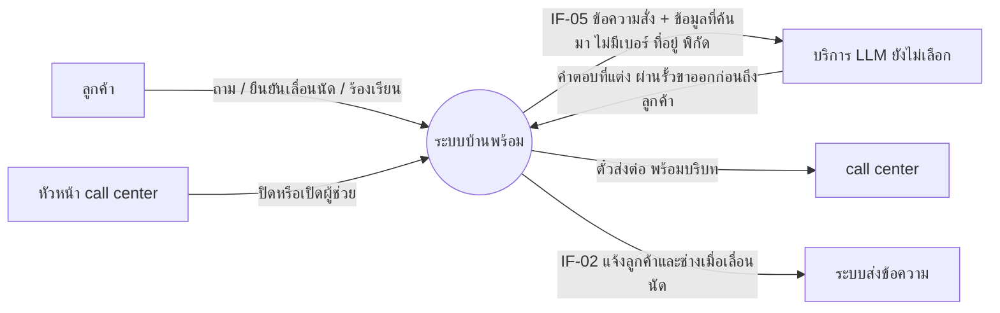
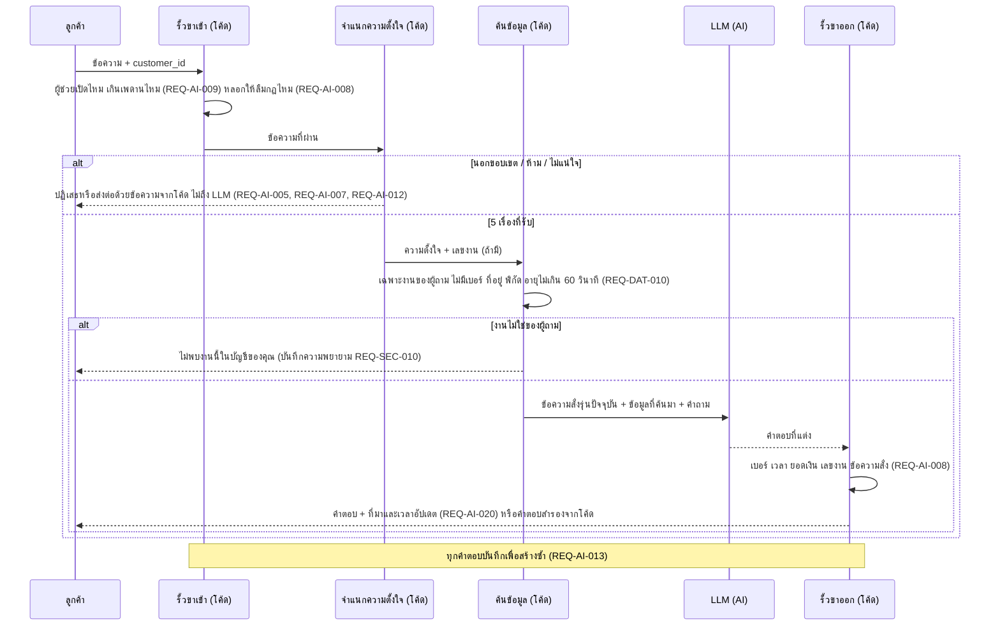
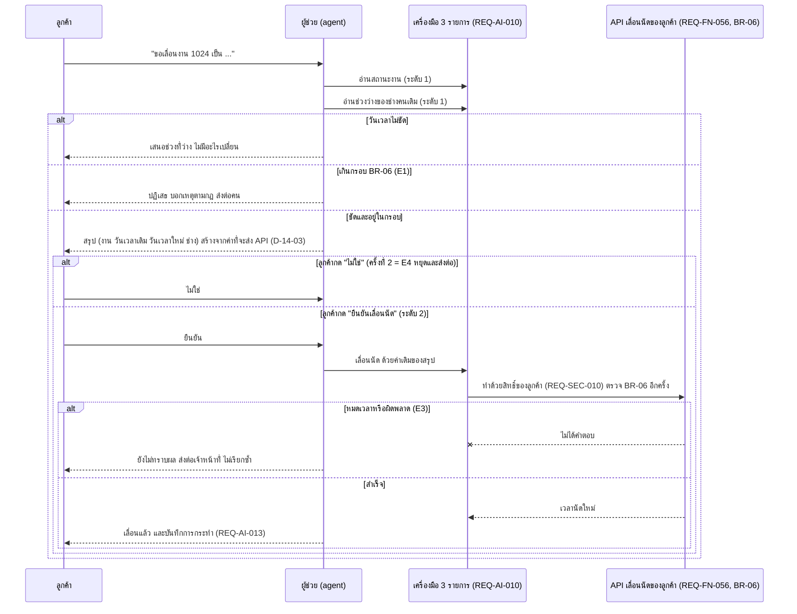
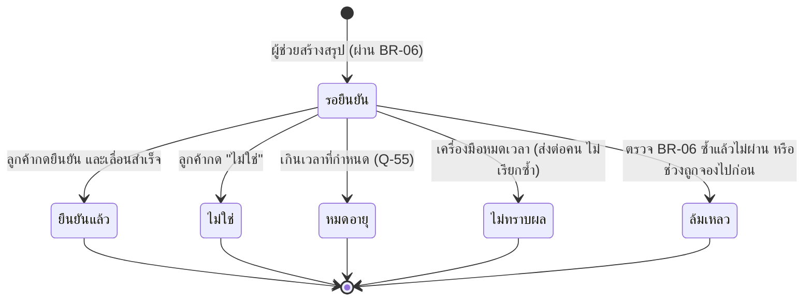

# โมเดลที่ UC-14 ใช้ (MD-CTX-14, MD-SEQ-14-01, MD-SEQ-14-02, MD-STM-02)

เวอร์ชัน 0.1 ร่าง (เสนอผ่าน CR-09) | เขียนด้วย Mermaid เปิดดูภาพได้บน GitHub
MD-DOM-01 (Job, TimeSlot, Technician) และ MD-STM-01 (สถานะงาน 8 ค่า) ใช้ร่วมกับ SPEC-BOOKING อยู่ที่ specs/002-booking/models.md ไม่คัดลอกมา
การเลื่อนนัดไม่เปลี่ยนสถานะงานใน MD-STM-01 เปลี่ยนแค่ช่วงเวลาและเวลานัด

## MD-CTX-14 Context Diagram (เฉพาะส่วนที่ UC-14 แตะ)

## MD-SEQ-14-01 ตอบคำถาม RAG 5 ขั้น (UC-14 ขั้น 2 ถึง 7, A1 ถึง A3)

## MD-SEQ-14-02 เลื่อนนัด (UC-14 A4, E1 ถึง E4)

## MD-STM-02 สถานะของข้อเสนอเลื่อนนัด

